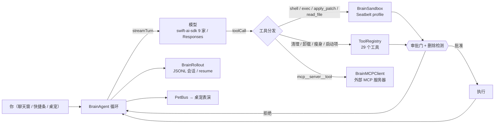

<div align="center">


# Moppet

**会干活的 macOS 清理工具。** 14 个清理模块 + Codex 级 agent 大脑 + 程序化 3D 桌宠，全部本地运行。

[](LICENSE)
[](#要求)
[](#要求)
[](#内置工具与-mcp29-个)
[](#验证)
[](#许可与致谢)

[中文](#moppet) · [English](#english)

</div>

> **不是又一个清理软件。** 别的工具给你一个勾选列表；Moppet 给你一个**能自己动手、但每次删除都要你点头**的智能体，外加一个蹲在桌面右下角、会把结果讲给你听的宠物。
>
> 纯 SwiftUI + SceneKit，**没有 WebView、没有 Electron、没有云端**。断网也能正常清理；只有你配置了 AI 供应商时，对话与 AI 工具才会参与。

---

## 目录

- [为什么是 Moppet](#为什么是-moppet)
- [界面一览](#界面一览)
- [快速开始](#快速开始)
- [功能模块](#功能模块)
- [桌宠](#桌宠)
- [Brain：Codex 能力对齐](#braincodex-能力对齐)
- [审批与沙箱决策表](#审批与沙箱决策表)
- [内置工具与 MCP（29 个）](#内置工具与-mcp29-个)
- [AI 供应商](#ai-供应商)
- [安全模型](#安全模型)
- [扫描范围 = 你的勾选](#扫描范围--你的勾选)
- [配置与数据目录](#配置与数据目录)
- [性能](#性能)
- [国际化](#国际化)
- [项目结构](#项目结构)
- [验证](#验证)
- [已知边界](#已知边界)
- [路线图](#路线图)
- [贡献](#贡献)
- [许可与致谢](#许可与致谢)

---

## 为什么是 Moppet

| | 常见清理软件 | Moppet |
|---|---|---|
| 清理能力 | 分模块菜单，规则不透明 | 对齐 [mole](https://github.com/tw93/mole) 的全部模块（Clean / Uninstall / Optimize / Analyze / Status / Purge / Installer / History / Slim），外加**启动项管理** |
| 谁来做决定 | 你逐项勾选 | 你可以勾选，也可以**用自然语言让 agent 干活**——它先 dry-run 给你看，再等你批准 |
| 删除安全性 | "点一下就好" | 只删家目录、25 类保护路径、白名单永远优先、删除前二次校验、逐路径审计；**任何删除（含 AI、含补丁）都要审批** |
| AI 的形态 | 侧边栏聊天窗口 | 宠物本身就是对话入口：单击说话、双击开完整聊天窗、结果回到头顶气泡 |
| 可被外部驱动 | 无 | 内置 **MCP 服务器**（stdio + 回环 HTTP，29 个工具），Claude Code / Cursor / Codex 可以直接调用同一套清理能力 |
| 技术栈 | Electron / 大量框架 | 单进程 SwiftUI + SceneKit；4 个依赖；debug 二进制 74 MB，`--smoke` 全量自测约 3 秒 |

**它适合谁**：想要一个能真正解释"为什么删这个"的清理工具的人；愿意把删除权限交给一个有护栏的 agent 的人；喜欢桌宠作为交互层的人。

**它不适合谁**：只想要一个"一键瘦身"按钮的人（Moppet 一定会在删除前问你）；需要上架 Mac App Store 的场景（管理员提权与任意删除和沙箱冲突，见 [已知边界](#已知边界)）。

---

## 界面一览

```
┌───────────────────────────────┐            ┌──────────────────────────────┐
│  Moppet                       │            │  桌宠（透明置顶浮层，右下角）  │
│  ┌─────────┬─────────────────┐│            │                              │
│  │ 侧栏     │  磁盘环          ││            │      「找到 612 MB 🧹」       │
│  │          │                 ││            │        ╭──────╮              │
│  │ 总览      │  快捷卡 × 4      ││            │        │ (◍˃ᗜ˂◍) │ ← 3D 角色   │
│  │ 清理      │                 ││            │        ╰──────╯              │
│  │ 卸载      │  状态胶囊        ││            │                              │
│  │ 优化      │                 ││            │  单击=快捷输入条  双击=聊天窗  │
│  │ 启动项    │                 ││            └──────────────────────────────┘
│  │ 分析 …    │                 ││
│  └─────────┴─────────────────┘│            ┌──────────────────────────────┐
└───────────────────────────────┘            │  聊天窗 = 桌宠的完整对话       │
                                             │  你：帮我看看什么占了空间        │
┌───────────────────────────────┐            │  Moppet：先扫描 → 报结果       │
│  外部 MCP 客户端                │            │        → 等你批准 → 执行       │
│  Claude Code / Cursor / Codex  │──┐         └──────────────────────────────┘
└───────────────────────────────┘  └────────▶ 同一套 29 个工具、同一套安全门控
```

界面设计遵循三条硬规则：**跟随系统外观**（不钉浅色/深色，靠动态 token 保证两种模式都可读）、**卡片式分区**（12pt 圆角 + 1px 描边 + 柔和投影）、**数字与进度都有动效**（环形进度弹簧插值、数字滚动）。

---

## 快速开始

### 要求

| 项目 | 要求 |
|---|---|
| 系统 | macOS 14 (Sonoma) 或更新；Apple Silicon 与 Intel 均可 |
| 工具链 | Swift 6.0+（`swift-tools-version:6.0`；依赖 `swift-ai-sdk` 本身要求 6.0） |
| 网络 | 仅首次构建拉依赖需要；运行时除 AI 与模型清单外全离线 |

### 构建

```bash
git clone git@github.com:xsean2020/Moppet.git
cd Moppet
swift build            # 首次约 3–5 分钟（编译 4 个依赖）
.build/debug/Moppet    # 启动 GUI：主窗口 + 桌宠 + 菜单栏图标
```

`swift run Moppet` 等价。Xcode 可直接打开 `Package.swift`。

打包成 **.app**（带应用图标，可双击运行 / 拖进「应用程序」）：

```bash
./scripts/make-app.sh   # 构建 release 并产出 dist/Moppet.app（含图标与签名）
open dist/Moppet.app
```

### 运行模式

```bash
# ── GUI ────────────────────────────────────────────────
swift run Moppet                       # 主窗口 + 桌宠 + 菜单栏

# ── 自测（不删除任何文件）──────────────────────────────
swift run Moppet --smoke               # 237 项核心断言，约 3s
swift run Moppet --brain-smoke         # 226 项 agent 断言，约 3s

# ── 作为 MCP 服务器 ────────────────────────────────────
swift run Moppet --mcp                 # stdio（Claude Code / Cursor 常用）
swift run Moppet --mcp-http 8765       # 回环 HTTP（只绑 127.0.0.1）

# ── 无头 agent（codex exec 等价）───────────────────────
swift run Moppet --brain-exec "清理浏览器缓存并报告"        # 删除操作→拒绝
swift run Moppet --brain-exec "清理浏览器缓存并报告" --yes  # 自动批准
```

### 诊断开关

| 开关 | 用途 |
|---|---|
| `--probe-models` | 用当前订阅 token 拉取模型目录，打印 HTTP 状态与原始响应 |
| `--probe-floater` | 离屏渲染浮层配色，验证动态 token 在无边框面板里的解析结果 |
| `--route-perf` | 依次切换全部路由，打印每次提交/渲染耗时（排查卡顿） |
| `--win-debug` | 每 4 秒输出窗口 frame / visible / occlusion / key / firstResponder |

### 构建排错

<details>
<summary><b>编译报错指向 <code>Task</code></b></summary>

历史版本在 `OptimizeEngine` 内定义了一个嵌套类型也叫 `Task`，会把同文件的 `Task.detached` 解析成那个模型结构体（`type 'OptimizeEngine.Task' has no member 'detached'`）。已重命名为 `OptimizeTask`；如果你在旧副本里遇到，更新到最新 `main` 即可。
</details>

<details>
<summary><b>链接错误：<code>building for macOS-arm64 but attempting to link with file built for macOS-x86_64</code></b></summary>

`.build/` 是从别的机器（或别的架构）拷过来的。删掉重建：

```bash
swift package clean       # 或 rm -rf .build
swift build
```
</details>

<details>
<summary><b>依赖拉不下来</b></summary>

4 个依赖都在 GitHub。代理环境下先确认 `git ls-remote` 能通，再 `swift package resolve` 看具体是哪个仓库失败；必要时给 git 配镜像。
</details>

---

## 功能模块

侧栏 14 个入口。所有模块共用同一套安全层（见 [安全模型](#安全模型)），删除方式在 UI 上逐项标注。

| 模块 | 做什么 | 删除方式 |
|---|---|---|
| **总览** Dashboard | 磁盘环、4 张快捷卡、系统状态胶囊、会话数 | — |
| **清理** Clean | 4 分区 **24 条规则**（系统与用户 / 开发者 / 浏览器 / 安装包）；扫描前逐项勾选，复审页逐文件勾选 | 缓存/日志永久删除；安装包/归档进废纸篓 |
| **孤立残留** Orphans | 反查 `~/Library` 中**已卸载应用**的残留（Caches / Preferences / Containers / Support / LaunchAgents），按 bundle id 判定 | 进废纸篓（可恢复，启发式判定） |
| **卸载** Uninstall | 应用列表（名称/大小/图标）；关联残留（Preferences、Caches、Containers、Support、LaunchAgents、Group Containers）；系统级残留需管理员；App Management 拒绝时自动走管理员提权兜底（取消密码框则回到授权引导卡） | 应用与残留**永久删除**（不可恢复，删除前确认） |
| **项目清理** Purge | **21 类**可再生产物（node_modules、target、build、dist、.next、.gradle、Pods、`__pycache__`…），自定义根目录并行扫描 | 永久删除（确认框明确告知不进废纸篓） |
| **瘦身** Slim | 自读 fat header 扫描通用二进制 → 副本剥离 Intel 切片 → 原身份重签名 → codesign 校验通过才替换 | 原件进废纸篓；失败自动回滚；**仅 Apple Silicon** |
| **空间大户** Space Hogs | APFS 本地快照、Docker（镜像/容器/卷/构建缓存）、Homebrew 旧版本；iOS 备份 / 邮件 / 信息为只读报告 | 快照永久删、Docker prune、brew cleanup；只读项不删 |
| **大文件** Large Files | 按大小 Top N，可按最小体积与范围筛选；受保护路径（文档/桌面等）标锁 | 进废纸篓（可恢复） |
| **优化** Optimize | Finder/Dock 重启、DNS 刷新、Spotlight 重建、内存 purge、网络卷 .DS_Store、30 天+ Saved State、健康报告 | 不涉及用户数据 |
| **启动项** Startup | 扫描 `~/Library/LaunchAgents`、`/Library/LaunchAgents`、`/Library/LaunchDaemons`（`com.apple.*` 折叠计数）；显示 RunAtLoad / KeepAlive / loaded | **不删文件**：写 `Disabled` + `launchctl bootout` 立即停跑，可逆 |
| **状态** Status | CPU / 内存 / 网络 / 电池 / Top 进程 / uptime，2 秒刷新 | 仅 SIGTERM（带确认） |
| **分析** Analyze | 双栏：面包屑 + 目录列表 + 气泡图；两相扫描——展开先秒出列表、大小流式补全；可勾选任意路径 | 选中项**永久删除**（不可恢复，删除前确认） |
| **历史** History | 每次清理的逐路径审计（路径、字节、删除方式、成功/失败原因） | 只读 |
| **设置** Settings | AI 供应商与模型、ChatGPT 订阅登录、宠物名字/人格、白名单、语言、扫描缓存、MCP 开关 | — |

---

## 桌宠

程序化 **SceneKit 3D 角色**（几何体 + PBR 材质 + 三灯布光 + 接触阴影）——不依赖任何 3D 资源文件，构建完就能看到。

| 交互 | 行为 |
|---|---|
| **单击** | 弹出屏幕中央的快捷输入条（⏎ 发送 / Esc 关闭 / 点空白关闭 / 再点宠物切换）；回答**流式**显示在头顶气泡 |
| **双击** | 打开完整聊天窗（会话列表 + 历史 + 运行控制条） |
| **右键** | 快速扫描、打开主窗口、睡眠、退出 |
| **拖拽** | 自由摆放；位置持久化；跟随主窗口所在显示器 |
| **AI 需要删除时** | 头顶直接弹 **Approve / Deny** 内联卡片，不用切窗口 |
| **AI 提问时** | 头顶弹出紧凑问题卡（同一请求也会出现在聊天窗，先答者生效） |

**7 种状态动画**：待机（呼吸/摆动/随机眨眼）· 思考（浮动）· 说话（鼻尖脉冲）· 扫描（左右扫视）· 清理（颤抖）· 庆祝（跳跃旋转）· 睡觉（侧倒打鼾闭眼）。任何状态切换都会先重置基础姿态——不会卡在旋转一半朝向墙的姿势。

**气泡只讲结果**：工具调用与进度用姿态表达（扫描=扫视、清理=颤抖），不把过程文本塞进气泡。回答完成显示结果与 token 数；出错显示错误。

宠物与窗口互相独立：关掉所有窗口宠物还在；从宠物菜单或菜单栏能把主窗口/聊天窗重新拉起。

---

## Brain：Codex 能力对齐

`Sources/Moppet/Brain/` 是 codex-rs 核心能力集的 **Swift 重实现**（不是逐行翻译）。



| 能力 | 实现要点 |
|---|---|
| **agent 循环** | 流式 textDelta → 并行工具派发（TaskGroup）→ 结果回喂 → 直到无工具调用；轮数上限、取消、usage 统计 |
| **审批策略** | `untrusted` / `on-request` / `never` 三档；删除类命令在**任何交互策略**下都先问 |
| **沙箱** | Seatbelt 动态 profile：`read-only`（不授予任何写路径）/ `workspace-write`（工作区 + 额外可写根，realpath 规范化）/ `danger-full-access`；网络默认开、可关 |
| **shell** | workdir / timeout（钳制 1s–10min）/ 超长输出裁剪；超时与取消都会终止子进程 |
| **apply_patch** | 完整解析 Add/Update/Delete/Move + `@@` 上下文；**两阶段应用**（全部校验通过才落盘）；拒绝工作区根、解析符号链接、Move 保留内容修改、CRLF 保持、无锚点 hunk 报错 |
| **read_file / view_image** | 行号 + 字节预算；图片魔数嗅探（PNG/JPEG/GIF/WebP，≤10 MB）；**凭证文件硬拒绝**（`ai-keys.json`、`mcp.json`、rollout 目录） |
| **可恢复 exec 会话** | `exec_command` + `write_stdin`：spawn → yield → 按 id 轮询/喂 stdin；`/ps` `/stop` 管理；SIGTERM→SIGKILL 升级；输出管道并发排空（不会因 64KB 缓冲假超时） |
| **会话持久化** | rollout JSONL（meta / turn_context / response_item / compacted）；坏行跳过而不截断、压缩后 resume 不复活旧历史、并发写串行化 |
| **上下文压缩** | 阈值自动压缩 + `/compact` 真实模型摘要；**压缩不拆散 function_call/output 对**（否则 Responses 会持续 400） |
| **MCP 客户端** | stdio JSON-RPC：请求超时、错误响应回传、字符串 id、裸命令名查 PATH、服务器退出即失败未决请求、resources 三工具 |
| **指令发现** | `~/.moppet/AGENTS.md` + 根到 cwd 全祖先链拼接；persona 作为系统提示词第一段 |
| **斜杠命令** | `/help /status /mcp /new /compact /init /diff /pwd /cd /ps /stop /export /copy` |

**未移植**（平台级，与"桌宠大脑"无关）：多 agent 协作、云任务、语音、插件市场、code mode。

---

## 审批与沙箱决策表

同一张表驱动 `shell` 与 `exec_command`：

| 审批策略 | 命令类型 | 沙箱 | 是否询问 |
|---|---|---|---|
| `untrusted` | 任意 | 直接全权限执行 | **总是问** |
| `on-request`（默认） | 删除类（`rm`/`rmdir`/`unlink`/`shred`/`trash`、`git clean`、`find -delete`、`find -exec rm`、`xargs rm`、`sh -c "…"`、`$(…)`/反引号内的删除） | 先沙箱 | **先问**，批准后执行 |
| `on-request` | 非删除，沙箱内成功 | 沙箱 | 不问 |
| `on-request` | 非删除，沙箱越权（exit 125 / Seatbelt 拒绝） | 自动升级全权限重跑 | 不问（这是"除了删除都放行"的约定） |
| `never` | 任意 | 沙箱 | **从不问**；越权错误回喂模型 |

删除检测是**启发式**（还有一层通用闸门：所有删除类工具都必须走审批），误判方向偏安全——宁可多问一句。

---

## 内置工具与 MCP（29 个）

`ToolRegistry` 是唯一工具源：**App 内 agent 与外部 MCP 客户端调用同一实现、同一安全门控**。

| 类别 | 工具 |
|---|---|
| 状态 | `disk_status` `system_status` |
| 清理 | `list_clean_rules` `scan_clean`（dry-run，返回 token）`execute_clean`（需 token） |
| 分析 | `analyze_disk` `find_large_files` |
| 项目 | `find_project_artifacts` `purge_artifacts` |
| 卸载 | `list_apps` `app_related_files` `uninstall_app` |
| 启动项 | `scan_launch_items` `set_launch_item_enabled` |
| 瘦身 | `scan_slim` `slim_apps` |
| 空间大户 | `scan_space_hogs`（快照/Docker/brew/备份只读报告）`delete_local_snapshots` `docker_prune` `brew_cleanup` |
| 孤立残留 | `scan_orphans` `clean_orphans` |
| 优化 | `optimize_catalog` `run_optimize`（admin 任务只允许在 App 内跑） |
| 历史 | `clean_history` |
| 白名单 | `whitelist_list` `whitelist_add` `whitelist_remove` |
| 安全 | `safety_check` |

### 调用契约：先看，再删

破坏性工具在 MCP 通道上必须显式传 `"confirmed": true`，且清理必须带 `scan_clean` 发的 token：

```jsonc
// 1) dry-run（只读），拿 token
{"jsonrpc":"2.0","id":1,"method":"tools/call",
 "params":{"name":"scan_clean","arguments":{"sections":["browsers"]}}}
// → "Scan complete (nothing deleted). Scanned scope: safari-cache, chrome-cache, …"
//    "confirmation_token: 8F2C…"

// 2) 征得用户同意后执行
{"jsonrpc":"2.0","id":2,"method":"tools/call",
 "params":{"name":"execute_clean",
           "arguments":{"confirmation_token":"8F2C…","confirmed":true}}}
```

不带 `confirmed` → 直接拒绝；token 过期（30 分钟）或已用过 → 拒绝并要求重新扫描。白名单的增删也算破坏性操作，因为它们会改变"永不触碰"的边界。

### 接入外部客户端

**stdio**（Claude Code / Cursor / Codex 通用）：

```json
{
  "mcpServers": {
    "moppet": { "command": "/绝对路径/Moppet/.build/debug/Moppet", "args": ["--mcp"] }
  }
}
```

**HTTP**（Settings → MCP Server 打开开关，状态持久化、随 App 启动恢复；也可 `--mcp-http` 独立运行）：

```json
{ "mcpServers": { "moppet": { "url": "http://127.0.0.1:8765/mcp" } } }
```

> HTTP 端点**只监听 127.0.0.1**。它能执行删除类工具且没有额外鉴权——绑全网卡等于把删除权限交给整个局域网。

---

## AI 供应商

| 类别 | 说明 |
|---|---|
| **内置 9 家** | OpenAI · Anthropic · Gemini · DeepSeek · Groq · Mistral（原生 provider）· GLM · Ollama · 任意 OpenAI 兼容端点 |
| **自定义 Provider** | 任意多个；每个独立 key 槽位（`api-key.profile:<id>`）、独立模型清单、可选三种 API 格式 |
| **API 格式** | Chat Completions (`/chat/completions`) · Anthropic Messages (`/v1/messages`) · Responses (`/responses`) |
| **模型清单** | 内置厂商都能按 API 拉取各自的 listing 端点，也可手工增删；删除当前选中模型会自动回落到可用项 |
| **切换级联** | 聊天窗控制条 / 快捷条 / 设置页任一处切换 Provider 或模型，全局即时生效（下一条消息用新模型） |
| **凭证** | 全部存放在 `~/.moppet/ai-keys.json`（0600）。**不用钥匙串**：未签名的 SwiftPM 二进制每次重建签名都变，钥匙串 ACL 会反复弹授权。旧钥匙串条目首次读取时迁移并删除 |
| **订阅登录** | 浏览器 PKCE 授权码流（与 codex CLI 同一公共 client 与回调地址）；token 到期前用 `refresh_token` 静默续期；订阅后端只讲 Responses API，因此单独走一个 SSE 传输 |

---

## 安全模型

删除是这类工具唯一不可逆的动作，所以规则集中在 `SafetyGuard`，且**每条都在删除前复检**：

| # | 规则 | 强制点 |
|---|---|---|
| 1 | 只能删**家目录内**的路径；家目录本身、文件系统根、`/System`、`/usr` 等硬拒 | `checkDeletable` |
| 2 | **25 类保护路径**：钥匙串、Cookies、Messages、Mail、iCloud Drive、iOS 备份、Group Containers、Preferences、Accounts、Safari 配置、浏览器 profile 容器，以及 Documents / Desktop / Pictures / Music / Movies | `checkDeletable` |
| 3 | **白名单永远优先**：`~/.config/moppet/whitelist` 每行一个 glob，命中路径**及其整个子树**即拒绝 | `checkDeletable` + `isWhitelisted`（补丁路径同样受约束） |
| 4 | **符号链接解析后判定**：链接指向保护区内同样拒绝；补丁解析两侧 realpath，防止借链接写出工作区 | `checkDeletable` / `ApplyPatch.resolve` |
| 5 | **删除前二次校验**：扫描时过滤一次，真正删除前（永久与废纸篓两条路）再查一次 | `ScanEngine` + `CleanExecutor` |
| 6 | **逐路径审计**：每次清理记录路径、字节、删除方式、成功/失败原因；History 页可追溯 | `HistoryStore` |
| 7 | **AI 删除必须批准**：shell 删除命令、`apply_patch` 的 Delete/Move、全部破坏性工具在执行前弹审批；白名单文件即便在工作区内也不能被补丁删除 | `BrainTools` 审批门 |
| 8 | **凭证不可读**：`read_file` / `view_image` 对 `ai-keys.json`、`mcp.json`、rollout 目录硬拒绝 | `denyCredentialStores` |

**已知限制**：沙箱与审批是护栏而非内核隔离；管理员操作走 AppleScript 提权（等价 `sudo`），会弹系统密码框；"检查→删除"之间理论上存在文件系统竞态，Moppet 用解析后路径 + 删除前复检把窗口压到最小，但不宣称可抵御恶意本地进程。

---

## 扫描范围 = 你的勾选

清理页的勾选会**持久化**（`CleanSelectionStore`），并统一作用于三个扫描入口：

| 入口 | 行为 |
|---|---|
| Clean 页 Scan / Rescan | 只扫描勾选的项目 |
| 菜单栏 / 宠物右键 / `⌘S` 快速扫描 | 只扫描勾选的项目 |
| AI 的 `scan_clean` | **不传参数时扫描你勾选的项目**，而不是规则默认值；显式传 `sections` / `items` 时以显式为准 |

底栏实时显示「已选 N / M 个类别」，快速扫描播报「已扫描 N 个类别 · 找到 M 个路径」——范围永远可见、可核对。逐项取消勾选（"这条留着"）只对本次审查生效，重新扫描会按路径重新判定。

---

## 配置与数据目录

| 路径 | 内容 | 权限 |
|---|---|---|
| `~/.moppet/ai-keys.json` | 各厂商 / 各 profile 的 API key 与订阅 token | 0600 |
| `~/.moppet/ai-providers.json` | 自定义 Provider（可手编） | 0600 |
| `~/.moppet/brain/sessions/*.jsonl` | 会话 rollout（可 resume） | 0600 |
| `~/.moppet/brain/mcp.json` | Brain 接的外部 MCP 服务器 | 0600 |
| `~/.moppet/brain/persona.md` | 宠物人格（系统提示词第一段） | — |
| `~/.moppet/brain/size-cache.json` | 测量缓存（5000 条 / 3 天 TTL） | — |
| `~/.config/moppet/whitelist` | 永不删除的 glob（每行一条） | — |
| `~/Library/Application Support/Moppet/history.json` | 清理审计历史（≤200 条） | — |
| `UserDefaults` (`Moppet`) | 界面偏好、勾选状态、MCP 开关 | — |

旧版本（`Cleaner`）的用户数据在首次启动时一次性迁移。

<details>
<summary><b>示例：<code>mcp.json</code>（Brain 接外部 MCP 服务器）</b></summary>

```json
{
  "filesystem": { "command": "npx", "args": ["-y", "@modelcontextprotocol/server-filesystem", "/tmp"] },
  "github": { "command": "uvx", "args": ["mcp-server-github"], "env": { "GITHUB_TOKEN": "…" } }
}
```

裸命令名（`npx` / `uvx`）会按 PATH 解析；命令写错或服务器崩溃不会拖住整轮对话（请求有超时，进程退出即失败未决调用）。
</details>

<details>
<summary><b>示例：<code>whitelist</code></b></summary>

```text
~/Library/Caches/MyImportantApp/*
~/Projects/**
```
glob 语义：`*` 只匹配单段（不跨 `/`），`?` 匹配单字符；命中的路径**及其子孙**都不会被删除。
</details>

---

## 性能

| 手法 | 效果 |
|---|---|
| **并行测量** | 目录大小按 TaskGroup 分扇下钻（宽度 8），替代串行递归 |
| **跨启动缓存** | 测量结果入 `size-cache.json`（5000 条 LRU / 3 天 TTL）；目录 mtime 变化即失效 |
| **两段式列表** | 卸载页先秒出元数据，大小后台并行补齐（单调进度）；分析页两相扫描——先秒出 ls 级列表、大小流式补全（大目录展开不再冻结） |
| **后台 I/O** | 会话枚举、`ps` 采样、大目录遍历、缓存读写都在后台线程；UI 状态统一回主线程 |
| **轻量会话** | 侧栏会话列表只读文件头，标题流式早停 |

实测（本机 Intel，debug 构建）：同一范围的 MCP 扫描**热启动 0.26 s**（含进程启动，命中缓存）；`--smoke` 全量 237 项 **约 2.9 s**，`--brain-smoke` 226 项 **约 2.9 s**（均含进程启动）。

> 缓存的一个真坑：目录变更检测必须用 `attributesOfItem(.modificationDate)`。`URL.resourceValues(.contentModificationDateKey)` 对目录在 macOS 26 上不随子项变化更新，用它做判断会让缓存永久命中（等于没失效）。

---

## 国际化

轻量 `L10n`：键即英文原文，`L("Scan")` → "扫描"，548 条中文词条。跟随系统语言，Settings 可即时切换（System / English / 中文），切换会刷新整个界面。

对贡献者的硬要求：中英表里出现重复 key 会产生**编译警告**并在首次初始化时 **TRAP**，所以构建必须保持 **0 warning**（`--smoke` 的第一条断言就是自检）。

---

## 项目结构

```
Sources/Moppet/                     93 个 Swift 文件 / ~33k 行
├── App/
│   ├── PetPanel.swift              NSPanel 容器、窗口路由与离屏修复、快速扫描、AppDelegate
│   ├── PetView.swift               SceneKit 角色 + 气泡 + 内联审批/提问卡 + 右键菜单
│   ├── QuickChat.swift             快捷输入面板（一次性 agent 会话）
│   ├── ScrollbarTuner.swift        全应用极细滚动条（hover/滚动淡入）
│   ├── TextFocus.swift             输入焦点时序助手（IME 安全）
│   └── AnalyzeRenderProbe.swift    --render-probe 离屏渲染自检
├── Brain/
│   ├── BrainAgent.swift            循环、压缩、会话、MCP 连接、事件广播
│   ├── BrainTools.swift            shell / read_file / apply_patch / exec / plan / 提问 + 清理工具桥接
│   ├── BrainSandbox.swift          Seatbelt profile、并发管道、删除检测
│   ├── BrainExec(Session).swift    可恢复 exec 会话 / 无头 --brain-exec
│   ├── ApplyPatch.swift            补丁解析与两阶段应用
│   ├── BrainRollout.swift          rollout JSONL 读写 + AGENTS.md 发现
│   ├── BrainMCPClient.swift        MCP 客户端（stdio）
│   ├── BrainSlash.swift            斜杠命令
│   ├── BrainUserInput.swift        结构化提问（超时/幂等）
│   ├── BrainTypes.swift            事件、策略、会话项类型
│   └── BrainSmokeTest.swift        --brain-smoke
├── Core/
│   ├── ToolRegistry.swift          29 个工具 + JSON Schema + 门控 + 确认 token
│   ├── SafetyGuard.swift           保护路径、白名单、glob
│   ├── ScanEngine.swift            pattern 展开、并行测量、缓存接入
│   ├── BatchDeleter.swift          分层批量删除（直删/展开两层 + 白名单子树保护）
│   ├── RuleLibrary.swift           4 分区 24 条规则
│   ├── CleanExecutor.swift         执行 + HistoryStore 审计
│   ├── CleanSelectionStore.swift   勾选持久化（三个扫描入口共用）
│   ├── SizeCache.swift             跨启动测量缓存（LRU + mtime + TTL）
│   ├── Models.swift                领域模型
│   ├── AIAgent.swift               AISettings / AISettingsCoordinator / 模型工厂
│   ├── AIProviders.swift           自定义 Provider 注册表与模型目录
│   ├── CodexSubscription.swift     订阅 PKCE 登录 + Responses 传输 + 模型目录
│   ├── MCPServer.swift             stdio JSON-RPC 服务器
│   ├── MCPHTTPServer.swift         回环 HTTP 传输 + App 内开关
│   ├── PetBus.swift                事件总线 + 审批中心（队列）
│   ├── PetIdentity.swift           名字与人格
│   ├── Stickers.swift              贴纸资源映射
│   ├── L10n.swift                  中英词表
│   ├── LegacyMigration.swift       旧版数据迁移
│   ├── SmokeTest.swift             --smoke
│   ├── Permissions.swift           TCC / 完全磁盘访问探测
│   ├── Scheduler.swift             定时清理 LaunchAgent + --scheduled-clean
│   └── Modules/
│       ├── UninstallEngine.swift   应用与残留、系统级残留（管理员）
│       ├── OptimizeEngine.swift    维护任务
│       ├── PurgeEngine.swift       项目产物 + 大文件
│       ├── SlimEngine.swift        通用二进制瘦身（Apple Silicon）
│       ├── LaunchItemsEngine.swift 启动项启停
│       ├── SnapshotEngine.swift    APFS 本地快照（tmutil）
│       ├── DockerEngine.swift      Docker df / prune
│       ├── HomebrewEngine.swift    brew cleanup 预览/执行
│       ├── SystemHogs.swift        iOS 备份 / 邮件 / 信息 只读报告
│       ├── OrphanResidueEngine.swift 孤立残留（bundle id 反查）
│       └── SystemStatus.swift      Mach / sysctl / IOKit 指标
├── Theme/                          Airi 设计 token + 通用组件
├── ViewModels/                     CleanViewModel、ChatSessionStore
├── Views/                          各模块页面 + MoppetApp（Window 场景 / 路由）
└── Resources/                      airi 贴纸（MIT）+ idle_loop.vrma（未来 VRM 资产）
```

---

## 验证

```bash
$ swift build
Build complete!          # 0 error / 0 warning

$ swift run Moppet --smoke
237 ✓  SMOKE PASS        # ~2.9s

$ swift run Moppet --brain-smoke
226 ✓  BRAIN SMOKE PASS  # ~2.9s
```

| 套件 | 覆盖 |
|---|---|
| `--smoke`（237） | 安全判定与 glob、规则库完整性、JSON 往返、磁盘/系统指标、工具注册表与破坏性门控、确认 token、缓存失效、补丁边界（删工作区根 / 无锚点 hunk / 两阶段）、勾选持久化与扫描范围、压缩配对安全、快照/Docker/brew 解析器、孤残分类规则、定时 LaunchAgent plist、CSV/JSON 导出、分层批量删除（直删/展开两层、符号链接目标不受伤、白名单子树保护） |
| `--brain-smoke`（226） | apply_patch 真实文件操作、Seatbelt 沙箱三档、脚本化模型驱动的多轮循环、rollout 恢复、MCP 客户端往返、exec 会话 stdin、图片项、无头提问回落、斜杠命令 |
| MCP | `initialize` → `tools/list`（29）→ `scan_clean` 真实结果 → 无 `confirmed` 被拒 → `safety_check` DENIED |
| HTTP | 只监听 `127.0.0.1`，`tools/list` 返回 29 |
| 架构 | `swift build --triple arm64-apple-macosx14.0` 与 `x86_64-apple-macosx14.0` 均全量交叉编译通过 |

---

## 已知边界

- **Slim 仅 Apple Silicon**：剥离 x86_64 切片后 Intel 机无法运行，运行时用 `hw.optional.arm64` 硬门禁。重签名后公证票据失效，首次启动由 Gatekeeper 在线校验，个别应用可能要求重新信任；失败的替换会把原件从废纸篓移回。
- **VRM 皮肤需要自备 `.vrm`**：仓库里的 `idle_loop.vrma` 只是待机动作片段，不含角色模型（上游 airi 因授权限制也不分发模型）。当前宠物是代码生成的 3D 角色。
- **App Store 不可直接上架**：管理员提权、任意删除、本地 HTTP 监听与沙箱冲突，详见 [`APPSTORE_PLAN.md`](APPSTORE_PLAN.md)。
- **Brain 的范围是"桌宠大脑"**：多 agent、云端任务、语音不在其中。
- **系统关键项**需要管理员密码（AppleScript 提权，等价 `sudo`）；普通项不需要。
- **AI 功能需要你自己的 key 或 ChatGPT 订阅**；不配置时清理功能完全可用。

---

## 路线图

- [x] 14 个清理模块（含启动项、瘦身、孤立残留、空间大户、大文件）
- [x] Codex agent 能力移植（循环/沙箱/审批/补丁/会话/压缩/MCP）
- [x] MCP 服务器（stdio + 回环 HTTP，29 工具）
- [x] 扫描范围持久化（Clean / 快速扫描 / AI 三入口一致）
- [x] ChatGPT 订阅登录 + token 自动续期
- [x] 大文件专用 UI（Top N + 最小体积/范围筛选 + 受保护标记）
- [ ] 重复文件查找（目前可经 AI 工具完成）
- [ ] VRM 皮肤（glTF 网格加载 + VRM 扩展解析 + `idle_loop.vrma` 驱动）
- [x] 空间大户（APFS 快照 / Docker / Homebrew）
- [ ] 更多清理分区（各类 AI 缓存）
- [ ] 菜单栏常驻的精简监控视图

---

## 贡献

```bash
swift build                                   # 必须 0 error / 0 warning
swift run Moppet --smoke && swift run Moppet --brain-smoke
```

- 新清理规则加在 `Core/RuleLibrary.swift`，必须同时确认 `SafetyGuard` 不会放行不该删的路径，并补 `--smoke` 断言。
- 改动删除路径时，**不要**绕过 `checkDeletable` 与删除前复检。
- 新增 UI 文案必须走 `L()`，并在 `L10n.swift` 补中文（注意不要产生重复 key）。
- 涉及并发状态时优先用锁或收敛到主线程，本项目按 Swift 5 语言模式编译（manifest 已显式锁定）。

---

## 许可与致谢

本项目以 **Apache-2.0** 发布，见 [`LICENSE`](LICENSE)。

| 来源 | 关系 |
|---|---|
| [mole](https://github.com/tw93/mole)（GPL-3.0，tw93 商标） | **只借鉴功能设计，未复制其代码或规则表** |
| [airi](https://github.com/moeru-ai/airi)（MIT） | 表情贴纸与 `idle_loop.vrma` 随包分发；界面参照其公开设计规范独立实现 |
| [OpenAI Codex](https://github.com/openai/codex)（Apache-2.0） | Brain 为其 agent 能力的 Swift 重实现 |
| [swift-ai-sdk](https://github.com/teunlao/swift-ai-sdk)（Apache-2.0） | 多厂商 provider、流式、工具调用 |
| [MarkdownUI](https://github.com/gonzalezreal/swift-markdown-ui)（MIT） | 聊天消息 Markdown 渲染 |
| [KeychainAccess](https://github.com/kishikawakatsumi/KeychainAccess)（MIT） | 仅作旧钥匙串条目的一次性迁移源 |
| [LaunchAtLogin-Modern](https://github.com/sindresorhus/LaunchAtLogin-Modern)（MIT） | 开机自启 |

---

<div align="center">

**Moppet** — 先擦，再聊。

</div>

---

<a id="english"></a>

<details>
<summary><b>English summary</b> (click to expand)</summary>

### Moppet

A native macOS cleaner that also talks. **14 cleaning modules** (dashboard, clean, orphans, uninstall, purge, slim, space hogs, large files, optimize, startup items, status, analyze, history, settings) plus a **Codex-class coding agent** living in a 3D desktop pet, plus a **29-tool MCP server** so Claude Code / Cursor / Codex can drive the same cleaning engine.

Zero WebView, zero Electron, zero cloud: it cleans fine offline; AI only joins when you configure a provider.

**Safety first.** Deletes are restricted to your home directory, blocked for 25 protected path classes, always defer to your whitelist (matching a path *and its whole subtree*), re-validated immediately before removal, and every path lands in an audit log. Every AI deletion — shell deletes, patch deletes, destructive tools — requires your approval. The MCP transport requires an explicit `"confirmed": true` plus a scan token, and the HTTP listener binds loopback only.

**Build & run**

```bash
git clone git@github.com:xsean2020/Moppet.git && cd Moppet
swift build                # Swift 6.0+, macOS 14+, ~3–5 min first time
.build/debug/Moppet        # GUI: main window + pet + menu bar

swift run Moppet --smoke          # 237 assertions, no files touched
swift run Moppet --brain-smoke    # 226 assertions
swift run Moppet --mcp            # MCP over stdio
swift run Moppet --mcp-http 8765  # MCP over loopback HTTP
swift run Moppet --brain-exec "clean my browser caches" --yes   # headless agent
```

**Scan scope follows your ticks.** The Clean page selection is persisted and shared by the Clean page, the quick scan (menu bar / pet menu / ⌘S) and the AI's no-argument `scan_clean` — it never silently widens to the rule defaults.

See the sections above for the full module table, the approval/sandbox decision matrix, MCP setup, configuration paths, measured performance and known limits.

</details>
