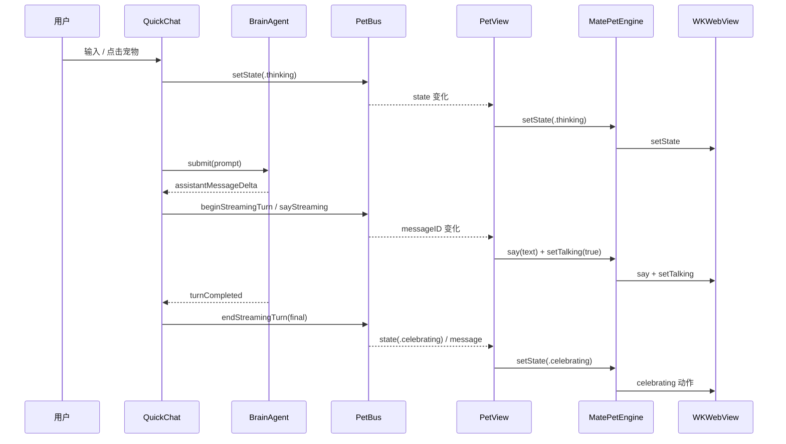

# MATE-PET-MODULE — MatePet 桌宠模块技术规格

> 版本：1.1（2026-11-13）
> **后端说明**：macOS 15+ 默认使用 `MatePetNativeEngine`（RealityKit + VRMRealityKit），本文主要描述 WebView 兼容后端（macOS 14 回退）。原生后端规格见 [`MATE-PET-NATIVE.md`](MATE-PET-NATIVE.md)。
> 适用范围：`Sources/MatePet/`、`Sources/Moppet/App/PetPanel.swift`、`Sources/Moppet/App/PetView.swift`、`Sources/Moppet/App/MatePetWander.swift`、`Sources/Moppet/App/PetShotProbe.swift`
> 目标读者：后续 AI agent / 工程师。按本文可 100% 复刻本模块的行为与实现。
> 状态：已实现并通过 `swift build`、`--probe-pet-shot`（idle / celebrating / dance / sleeping / sad / chibi）、`--probe-pet-panel`。

---

## §1 摘要

MatePet 是 Moppet 的独立桌宠模块，使用 Mate-Engine 提供的 **`Zome.vrm`**（VRM 0.x）作为角色，在 **WKWebView + three.js r180 + @pixiv/three-vrm 3.4.2** 中渲染。桌宠的“大脑”不迁移：仍然是 Moppet 现有的 `PetBus → QuickChat → BrainAgent` 链路。MatePet 只接收状态与用户意图，输出骨骼姿势、表情、口型、粒子与 Web Audio 音效。

核心原则：

| 原则 | 说明 |
| --- | --- |
| 独立模块 | `MatePet` 是独立 SwiftPM target，不 import Moppet 的 Core / Brain / 清理代码 |
| 双后端 | `MatePetRendering` 协议统一宿主 API：macOS 15+ 原生 RealityKit，macOS 14 WebView 回退 |
| 资源原样 | 直接使用 Mate-Engine 的 `Zome.vrm`，不转格式、不重烘焙模型 |
| 单文件页面 | 所有 HTML/CSS/桌宠 JS 在 `mate-pet.html` 一个文件内；只有 three.js / three-vrm / VRM 作为外部静态资源 |
| 大脑不变 | `PetBus` 仍是唯一事件出口，`PetView` 把状态映射给 `MatePetEngine` |
| 原生交互 | 拖拽、点击、double-click、右键、鼠标跟随全部由 AppKit `NSView` 处理，不依赖 SwiftUI 手势在后台应用状态下的不可靠行为 |

---

## §2 术语

| 术语 | 含义 |
| --- | --- |
| VRM 0.x | glTF 2.0 + `VRM` 扩展；本模型含 53 根 humanoid 骨骼、24 组 BlendShape、`secondaryAnimation` 头发/裙摆弹簧 |
| normalized bone | three-vrm 的“归一化人形骨骼”，用于写姿势；`vrm.update()` 会把它同步到 raw bone |
| raw bone | glTF 真实骨骼；缩放（Chibi）与 eye look-at 的最终落点 |
| mode | 覆盖状态机的一次性动作（dance / hide / appear / wake / stretch / wave） |
| state | 与 `PetBus` 对齐的 8 种情绪/工作状态 |
| probe mode | `mate-pet.html?probe=1`，页面懒加载完成后自行 `canvas.toDataURL()` 回传 PNG |
| asset server | 模块内仅绑定 `127.0.0.1` 的随机端口只读 HTTP 服务 |

---

## §3 选型与理由

### §3.1 为什么不用 SceneKit / RealityKit

| 约束 | 结论 |
| --- | --- |
| `Zome.vrm` 是 VRM 0.x（glTF + `VRM` 扩展） | SceneKit / RealityKit 不能直接加载 VRM；需要先转 USDZ/glTF，表情、MToon 材质、springBone 会丢失或需重做 |
| Mate-Engine 的 `.anim` 是 Unity Humanoid 肌肉曲线（`RootT/RootQ` + 肌肉名） | 不是 glTF AnimationClip；脱离 Unity 运行时要重新实现 Humanoid muscle-space 解算 |
| 需要保留 Zome 的原始材质、24 组 BlendShape、视线 | three-vrm 是唯一能原样读取这些数据的成熟运行时 |

因此选择 **WKWebView + three-vrm**。代价是引入 WebView 与本地静态服务，收益是模型、表情、骨骼、springBone 全部原样可用。

### §3.2 为什么需要本地 HTTP 服务

`file://` 加载的 WKWebView 页面是 opaque origin：

| 问题 | 表现 |
| --- | --- |
| ES Module import | `import "three"` / `import "./vendor/three-vrm.module.js"` 被 CORS / Origin null 拦截 |
| GLTFLoader 读取 `.vrm` | `fetch`/XHR 到 `file://.../Zome.vrm` 被 WebKit 拒绝 |
| Import map | 依赖上述同源加载，失败后页面根本不执行 |

模块内启动 `MatePetAssetServer`，页面从 `http://127.0.0.1:<随机端口>/mate-pet.html` 加载。服务器只绑定 loopback、随机端口、扩展名白名单、路径前缀校验、请求结束立即关闭连接。

### §3.3 为什么大脑不放进 MatePet

`PetBus` 里有流式回合、任务车道聚合、审批、并行任务等复杂状态；把它塞进渲染模块会让 MatePet 与 Moppet 的清理/网络/审批逻辑强耦合。保留 `PetBus` 在 app target，MatePet 只暴露小的 `MatePetEngine` API，符合“独立模块”。

---

## §4 模块架构

```
┌──────────────────────────── Moppet.app（宿主） ────────────────────────────┐
│ QuickChat / ChatSessionStore / BrainAgent / ToolRegistry                  │
│        │ BrainEvent                                                        │
│        ▼                                                                   │
│     PetBus（唯一事件出口）                                                  │
│        │ state / say / streaming / task answers                            │
│        ▼                                                                   │
│     PetView（SwiftUI：气泡、快捷输入、审批卡）                               │
│        │ setState / setTalking / say                                       │
│        ▼                                                                   │
│  PetPanelController ── 持有 ──► MatePetEngine（@MainActor）                 │
└───────────────┬────────────────────────────────────────────────────────────┘
                │ WKWebView + JS bridge
                ▼
┌──────────────────────────── MatePet（独立 target） ───────────────────────┐
│ MatePetEngine                                                             │
│   ├─ MatePetAssetServer（127.0.0.1 随机端口只读静态服务）                   │
│   ├─ WKWebView（透明、无滚动、无缩放、message handler "matePet"）           │
│   └─ JS 命令队列（page ready 前最多缓存 120 条，超出丢最旧）                │
│ MatePetSceneView（NSViewRepresentable，承载 webView）                       │
│ MatePetInteractionView（AppKit 拖拽/点击/双击/右键/鼠标跟随）                │
│ Resources/mate-pet.html（单文件 HTML + 全部桌宠逻辑）                        │
│ Resources/Zome.vrm、vendor/three.module.js、vendor/three-vrm.module.js …    │
└────────────────────────────────────────────────────────────────────────────┘
```

### §4.1 文件清单

| 文件 | 职责 |
| --- | --- |
| `Package.swift` | 新增 `MatePet` target；`.copy("Resources")` |
| `Sources/MatePet/MatePetState.swift` | `MatePetState` / `MatePetAction` / `MatePetHitRegion` / `MatePetEvent` / `MatePetSettings` |
| `Sources/MatePet/MatePetEngine.swift` | 引擎门面、WKWebView、JS 命令队列、事件解码、`onSnapshot` |
| `Sources/MatePet/MatePetAssetServer.swift` | 回环静态 HTTP 服务 |
| `Sources/MatePet/MatePetSceneView.swift` | SwiftUI 承载视图 |
| `Sources/MatePet/MatePetInteractionView.swift` | AppKit 交互层 + 面板拖拽 |
| `Sources/MatePet/Resources/mate-pet.html` | 页面、CSS、three/three-vrm 初始化、骨骼动画、状态机、音频、粒子、桥 |
| `Sources/MatePet/Resources/Zome.vrm` | Mate-Engine 角色（26 MB） |
| `Sources/MatePet/Resources/Animations/*.vrma` | Unity 离线烘焙的 18 个 Humanoid 动画 |
| `Sources/MatePet/Resources/vendor/three.module.js` | three.js r180（`three.core.js` 为同目录依赖） |
| `Sources/MatePet/Resources/vendor/three-vrm.module.js` | three-vrm 3.4.2 bundle |
| `Sources/MatePet/Resources/vendor/jsm/loaders/GLTFLoader.js` | GLTFLoader |
| `Sources/MatePet/Resources/vendor/jsm/utils/BufferGeometryUtils.js` | GLTFLoader 依赖 |
| `Sources/MatePet/Resources/vendor/licenses/*` | MIT 文本 |
| `Sources/MatePet/Resources/THIRD_PARTY_NOTICES.md` | 许可证与 Zome 再分发警告 |
| `Sources/Moppet/App/MatePetWander.swift` | 原生 NSPanel 漫步控制 |
| `Sources/Moppet/App/PetShotProbe.swift` | `--probe-pet-shot` 截图探针 |
| `docs/MATE-PET-MODULE.md` | 本文 |

### §4.2 资源依赖关系

```
mate-pet.html
  ├─ import map: "three" → ./vendor/three.module.js
  │              "three/addons/" → ./vendor/jsm/
  ├─ import GLTFLoader → ./vendor/jsm/loaders/GLTFLoader.js
  ├─ import VRMLoaderPlugin, VRMUtils → ./vendor/three-vrm.module.js
  └─ loader.load('./Zome.vrm')
```

`three.module.js` 内部 `import './three.core.js'`，两个文件必须同目录。

---

## §5 构建与运行

| 命令 | 说明 |
| --- | --- |
| `swift build` | 编译 Moppet + MatePet |
| `swift run Moppet` | 启动 GUI（主窗口 + MatePet 桌宠 + 菜单栏） |
| `.build/debug/Moppet --probe-pet-shot <png> [w] [h] [state] [chibi]` | 离屏渲染桌宠 PNG；`state` 可为 idle/thinking/talking/scanning/cleaning/celebrating/sleeping/sad/dance |
| `.build/debug/Moppet --probe-pet-panel` | 检查气泡变宽/变高时面板仍在屏幕内 |
| `./scripts/make-app.sh` | release 打包；会复制 `Moppet_Moppet.bundle` 与 `Moppet_MatePet.bundle`，并写入 ATS `NSAllowsLocalNetworking` |

### §5.1 打包注意

`scripts/make-app.sh` 必须同时复制两个 resource bundle：

```sh
for bundle in Moppet_Moppet.bundle Moppet_MatePet.bundle; do
  if [ -d "$ROOT/.build/release/$bundle" ]; then
    cp -R "$ROOT/.build/release/$bundle" "$APP/Contents/Resources/"
  fi
done
```

`Info.plist` 必须有：

```xml
<key>NSAppTransportSecurity</key>
<dict><key>NSAllowsLocalNetworking</key><true/></dict>
```

原因：页面通过 `http://127.0.0.1:<port>` 加载；没有 ATS 本地网络例外时，打包后的 app 可能拒绝该请求。

---

## §6 渲染管线（页面侧）

### §6.1 初始化顺序

1. `bridge` 先定义（`window.webkit.messageHandlers.matePet`）。
2. 创建 `WebGLRenderer`：`alpha:true`、`antialias:true`、`premultipliedAlpha:true`、`preserveDrawingBuffer:true`。
3. `renderer.setPixelRatio(min(devicePixelRatio, 2))`；`outputColorSpace=SRGBColorSpace`；`ACESFilmicToneMapping`；`exposure=1.02`；`setClearColor(0,0)`。
4. `Scene` + `PerspectiveCamera(30°, aspect, 0.05, 40)`。
5. 灯光：
   - `AmbientLight(0xffffff, 0.42)`
   - `HemisphereLight(0xffffff, 0x7b8aa0, 1.15)`
   - 主光 `DirectionalLight(0xfff5ec, 2.0)` at `(1.6, 2.4, 2.2)`
   - 补光 `DirectionalLight(0xdfeaff, 0.65)` at `(-2.2, 1.2, 1.4)`
   - 轮廓光 `DirectionalLight(0xffd7e4, 1.35)` at `(-0.6, 1.8, -2.4)`
6. 软阴影：256×256 canvas 径向渐变（中心 `rgba(0,0,0,.34)` → `0.15` → 透明），贴到 `PlaneGeometry(1.25, 0.72)`，`rotateX(-π/2)`，`y=0.002`，`depthWrite:false`。
7. `avatarRoot = Group()`；`scene.add(avatarRoot)`。

### §6.2 VRM 加载

```js
const loader = new GLTFLoader();
loader.register(parser => new VRMLoaderPlugin(parser));
loader.load('./Zome.vrm', onLoad, onProgress, onError);
```

`onLoad`：

1. `const vrm = gltf.userData.vrm`；缺失则报错。
2. `VRMUtils.rotateVRM0(vrm)`：VRM 0.x 的 `vrm.scene.rotation.y = π`，把默认 -Z 朝向转到 +Z（相机在 +Z）。
3. 遍历 mesh：`frustumCulled = false`（骨骼/头发包围盒会因动画变化而错误裁剪）。
4. `avatarRoot.add(vrm.scene)`。
5. 创建 `PetRig`；读取 query：`chibi=1` / `state=<state>`（探针用）。
6. `rig.resize()`；移除 loading veil；`bridge.post('modelReady')`。

### §6.3 相机拟合算法

`PetRig.measureGround()`：

```js
const savedY = root.position.y;
root.position.y = 0;
root.updateMatrixWorld(true);
const box = new THREE.Box3().setFromObject(root);
groundOffset = -box.min.y;
measuredHeight = max(0.25, box.max.y - box.min.y);
measuredWidth  = max(0.2,  box.max.x - box.min.x);
root.position.y = savedY;
```

`PetRig.fitCamera()` 使用**固定舞台**：

```js
const height = 1.55;
const width  = 1.35;
const vFov = camera.fov * DEG;
const hFov = 2 * Math.atan(Math.tan(vFov / 2) * camera.aspect);
const distance = Math.max((height * 0.5) / Math.tan(vFov / 2),
                          (width * 0.5) / Math.tan(hFov / 2)) * 1.22;
cameraGoal.set(0, height * 0.52, distance);
cameraLook.set(0, height * 0.50, 0);
```

固定舞台的原因：SkinnedMesh bbox、Chibi 头部缩放、烘焙动作都会让 bbox 大幅变化；动态 bbox 曾把相机推到极远，或反过来把大头裁掉。

**为什么用实测 bbox**：Chibi 的头部骨骼缩放对轮廓的影响远大于整体 root 缩放；固定 1.62m 会把大头裁出画面。实测 bbox 是唯一稳健方案。

### §6.4 透明与窗口

| 层 | 设置 |
| --- | --- |
| HTML | `html,body { background: transparent; overflow:hidden }` |
| canvas | `alpha:true`；`setClearColor(0,0)` |
| WKWebView | `underPageBackgroundColor = .clear`；`setValue(false, forKey:"drawsBackground")` |
| NSPanel | `isOpaque=false`；`backgroundColor=.clear`；`hasShadow=false` |
| 显示时机 | `alphaValue=0`，收到页面 `ready` 后 0.35s easeOut 到 1；3s 安全网 |

---

## §7 骨骼与姿态系统

### §7.1 骨骼采集

```js
const BONE_NAMES = [
  'hips','spine','chest','upperChest','neck','head',
  'leftShoulder','rightShoulder',
  'leftUpperArm','rightUpperArm','leftLowerArm','rightLowerArm','leftHand','rightHand',
  'leftUpperLeg','rightUpperLeg','leftLowerLeg','rightLowerLeg',
  'leftFoot','rightFoot','leftToes','rightToes',
  'leftEye','rightEye'
];
```

对每个名称：

- `normalized = vrm.humanoid.getNormalizedBoneNode(name)`；保存 `baseQuaternion = normalized.quaternion.clone()` 与 `offset = new THREE.Euler()`。
- `raw = vrm.humanoid.getRawBoneNode(name)`；Chibi 缩放与 eye 备选驱动使用 raw。

VRM 0.x 没有 `upperChest`，`getNormalizedBoneNode` 返回 null，代码全部 guard。

### §7.2 叠加规则

每帧：

```js
bone.quaternion.copy(baseQuaternion).multiply(offsetEulerQuaternion)
```

偏移由三部分组成：

1. `baseOffset`：常驻 T-pose → 自然站姿（手臂下垂）。
2. 状态/动作偏移：`addRot(name, x, y, z)` 累加欧拉角。
3. 视线偏移：头/颈/胸/脊柱按光标位置叠加。

**为什么要 base quaternion**：直接 `bone.rotation.set(...)` 会覆盖 VRM 的 rest rotation；用 `base * delta` 才能保证手臂轴、手指、脚掌的 rest 姿态不崩。

### §7.3 轴约定（VRM，面朝 +Z）

| 骨骼 | 动作 | 轴/符号 |
| --- | --- | --- |
| `leftUpperArm` | 手臂下垂 | `rot.z = -1.16`（+X 转向 -Y） |
| `rightUpperArm` | 手臂下垂 | `rot.z = +1.16`（-X 转向 -Y） |
| `leftLowerArm` | 手肘自然弯 | `rot.y = -0.30`, `rot.z = -0.14` |
| `rightLowerArm` | 手肘自然弯 | `rot.y = +0.30`, `rot.z = +0.14` |
| `head` | 低头 | `rot.x > 0` |
| `head` | 抬头 | `rot.x < 0` |
| `head` | 向右看（屏幕右） | `rot.y > 0` |
| `leftUpperLeg` | 向前抬腿 | `rot.x < 0` |
| `leftLowerLeg` | 屈膝 | `rot.x > 0` |

### §7.4 基础站姿（baseOffset）

| 骨骼 | X | Y | Z |
| --- | --- | --- | --- |
| leftShoulder | 0 | 0 | -0.035 |
| rightShoulder | 0 | 0 | +0.035 |
| leftUpperArm | -0.02 | -0.10 | -1.16 |
| rightUpperArm | -0.02 | +0.10 | +1.16 |
| leftLowerArm | +0.02 | -0.30 | -0.14 |
| rightLowerArm | +0.02 | +0.30 | +0.14 |
| leftHand | 0 | 0 | -0.05 |
| rightHand | 0 | 0 | +0.05 |
| leftUpperLeg | +0.01 | 0 | +0.015 |
| rightUpperLeg | +0.01 | 0 | -0.015 |

---

## §8 状态机与动作系统

> **当前实现**：WebView 后端也已优先播放 `./Animations/*.vrma`（three-vrm-animation）；只有 VRMA 缺失、加载中或没有对应动作时才使用下面的程序化姿态。原生后端同样优先 VRMA，见 `MATE-PET-NATIVE.md` §4.1。

### §8.1 状态映射（宿主）

`PetView` 中：

```swift
extension PetState {
    var matePetState: MatePetState {
        switch self {
        case .idle: return .idle
        case .thinking: return .thinking
        case .talking: return .talking
        case .scanning: return .scanning
        case .cleaning: return .cleaning
        case .celebrating: return .celebrating
        case .sleeping: return .sleeping
        case .sad: return .sad
        }
    }
}
```

`PetView.onChange(of: bus.state)`：

```swift
engine.setState(newState.matePetState)
engine.setTalking(newState == .talking)
```

### §8.2 状态 → 姿势 / 表情表

| state | 姿态要点 | 表情 |
| --- | --- | --- |
| idle | 呼吸 `sin(t*1.65)`；左右摆 `sin(t*0.48)`；重心 `sin(t*0.23)`；手臂微摆 | happy 0.1 |
| thinking | 头低 0.08 / 偏 0.2 / 侧 0.16；右手抬到下巴（upper z +0.48，lower z -0.95） | relaxed 0.55 + lookUp 0.45 |
| talking | 头随 `sin(t*3.1)` 点头；双手小幅比划 | happy 0.35 + viseme |
| scanning | 头 `sin(t*1.15)*0.48` 左右扫；右手遮额（upper z +0.95，lower z -1.1） | lookLeft / lookRight |
| cleaning | 脊柱前倾 0.09；双手前伸 `upper y=±0.55, x=-0.72`；前臂 `sin(t*8.5)` 擦洗 | angry 0.16 |
| celebrating | 双臂上举（left z +2.15，right z -2.15）；`jump=abs(sin(t*6.2))*0.095` | happy 1 + star 0.8 + heart 0.35 |
| sleeping | 头低 0.20 / 偏 0.16 / 侧 0.22；慢呼吸；Zzz 粒子 | blink 1 + relaxed 0.6 |
| sad | 头低 0.26；肩垮；双手下垂 | sad 1 |

### §8.3 一次性动作（mode）

`mode` 优先于 state：

| mode | 时长 | 行为 | 音频 |
| --- | --- | --- | --- |
| dance | 9.0s | 髋/脊柱/头/双臂/腿按 `t*5.4` 律动；每 0.7s 星星粒子 | 4/4 鼓点 + 贝斯 + 五声音阶，BPM 112 |
| hide | 0.65s | 下蹲 `modeY = -smooth(p)*0.95`；结束后 `hideFinished` | 下滑音 + 噪声 |
| appear | 0.65s | 从 -0.8 升起；canvas opacity 0→1 | 无 |
| wake | 0.9s | 伸懒腰 + 开心 | happy 琶音 |
| stretch | 1.5s | 双臂上举 + 抬头 | 无 |
| wave | 1.8s | 右手举起摆动 | 无 |

`mode` 结束后自动回到 state；`dance` 结束时 `audio.danceStop()`。

### §8.4 随机小动作（gesture）

idle 且无 mode / 拖拽时，每 8–15s 随机触发：

| gesture | 时长 | 动作 |
| --- | --- | --- |
| lookAround | 1.4s | 头 `sin(2πp)*0.32` 左右看 |
| stretch | 1.8s | 双臂上举 1.65 rad |
| fixHair | 1.8s | 右手抬到头发 |
| weightShift | 1.8s | 髋/脊柱/头轻微重心切换 |

### §8.5 走路

`applyWalk(t)`：

```js
const phase = t * 9;
leftUpperLeg  rot.x = -sin(phase)*0.34
rightUpperLeg rot.x = +sin(phase)*0.34
leftLowerLeg  rot.x = 0.12 + max(0, sin(phase))*0.35
rightLowerLeg rot.x = 0.12 + max(0,-sin(phase))*0.35
leftUpperArm  rot.z = -sin(phase)*0.28
rightUpperArm rot.z = +sin(phase)*0.28
jump = abs(sin(phase))*0.012
```

每跨半步播放一次 `audio.step()`（`band-pass` 900Hz 短噪声）。原生侧移动面板，JS 只负责腿/臂/身体。

### §8.6 拖拽

原生交互层把鼠标位移发送给页面：

- `dragBegan`：`dragActive=true`，能量清零。
- `dragMoved(dx,dy)`：低通 `energy = energy*0.45 + delta*0.55`。
- `dragEnded(vx,vy)`：`energy = clamp(v*0.004, ±2.2)`，`lean = clamp(-energy.x*0.10, ±0.42)`。
- 每帧：`energy` 衰减 `damp(...,0,7,dt)`；`lean` 阻尼到 0（`damp 9`）。
- 姿势：髋/脊柱/胸按 lean 后仰；双臂上抬（left z +1.75，right z -1.75）；膝盖弯曲、双腿 `sin(t*9)` 摆动。
- 表情：surprised 0.6。

### §8.7 戳一戳 / 摸头

| 事件 | 触发 | 行为 |
| --- | --- | --- |
| 头部 click | 命中区域 `y > 52%` | 头歪 0.22、侧偏 0.18、Wink（count≥2）、2 颗爱心、`audio.poke()` |
| 身体 click | 其余区域 | 小跳 0.016、双臂外张 0.22、surprised 0.8、2 颗星星 |
| 连续摸头 | 1.6s 内头部 click ≥3 | `engine.play(.pet)`：purr、6 颗爱心、happy 1 + wink 0.9 + heart 0.8 |
| 拖拽 | 移动 ≥6px | 不触发 click/poke，只走拖拽物理 |

### §8.8 Chibi

复刻 Mate-Engine `ChibiToggle` 的比例：

| 层 | 全开时 |
| --- | --- |
| root（整体） | `scale = 1 - 0.68*mix = 0.32` |
| head（raw bone） | `scale = 1 + 1.7*mix = 2.7` 相对 |
| left/rightUpperLeg | `scale = 1 - 0.4*mix = 0.6` 相对 |

世界尺寸：身体 0.32×，头 0.32×2.7 = 0.864×，头部相对身体 2.7×，大腿 0.32×0.6 = 0.192×。切换时 `audio.chibi()` + 8 个 spark 粒子；`measureGround()` 重算地面与 `fitCamera()` 平滑变焦。

Chibi 相机：舞台按 `1 - 0.30*mix` 收缩（1.55m → 1.09m），视线中心随之下移 `0.03*height` 留出脚底余量。原因是 SkinnedMesh 的 `Box3` 只反映 bind pose，骨骼缩放不可见，不能用实测 bbox 拟合；按固定比例收缩舞台可避免大头/长发被裁切，同时保持画面占比约 60–74%。

---

## §9 表情、眨眼、口型、视线

### §9.1 表情探测

VRM 0.x 的 preset 名与 three-vrm 标准名不完全一致，运行时探测：

| 语义 | 候选名 |
| --- | --- |
| happy | `happy`, `joy`, `Joy`, `Fun` |
| sad | `sad`, `sorrow`, `Sorrow`, `Sorrow2` |
| relaxed | `relaxed`, `Fun`, `Fun2` |
| surprised | `surprised`, `Fun2`, `Fun` |
| angry | `angry`, `Angry` |
| blink | `blink`, `Blink` |
| blinkLeft / Right | `blinkLeft` / `Blink_L`; `blinkRight` / `Blink_R` |
| aa/ih/ou/ee/oh | `aa/A`, `ih/I`, `ou/U`, `ee/E`, `oh/O` |
| lookUp/Down/Left/Right | 标准名或 `LookUp` 等 |
| 彩蛋 | `Heart`, `Star`, `Niyari`, `Wink` |

`expressionManager.expressions.map(e => e.expressionName)` 得到可用集合；缺失的返回 null，`setExpr` 直接跳过。

### §9.2 表情混合

每帧：

```js
expressionTarget = {};      // 由 state/mode/talking/poke 用 max() 累积
for each expression:
    current = damp(current, target, 12, dt);
    expressionManager.setValue(name, current);
expressionTarget = {};
```

使用 `max` 而不是覆盖，避免“blink 把 happy 顶掉”。

### §9.3 眨眼

| 参数 | 值 |
| --- | --- |
| 单次时长 | 150ms（`smooth` 上升 + 下降） |
| 间隔 | 2100–6000ms 随机 |
| 连眨 | 18% 概率 420ms 后补一次 |
| 睡眠 | 强制 `blink=1` |

### §9.4 口型 viseme

`talking && now < talkingUntil` 时：

- 每 70–150ms 切换一个元音 `[aa, ih, ou, ee, oh]`；
- 权重 `0.42 + 0.22*abs(sin(now*0.025))`；
- `say(text, seconds)` 时长 = `clamp(1.2 + len*0.035, 1.2, 6.5)`，可由宿主覆盖（流式回答传入气泡显示间隔）。

> 注：VRM 没有音素对齐数据；这里用伪随机 viseme 制造“在说话”的观感，不追求精确 lip-sync。

### §9.5 视线

| 部位 | 范围 | 平滑 |
| --- | --- | --- |
| 头 yaw | ±38° | `damp 9` |
| 头 pitch | ±24° | `damp 9` |
| 颈/胸/脊柱 | yaw 的 0.28 / 0.12 / 0.10 | 同帧 |
| 眼 | three-vrm `lookAt`（若 VRM 定义）或 normalized eye bone ±0.35 倍 | `vrm.update` |

指针坐标从 AppKit 归一化到 `[0,1]`，页面转 `[-1,1]`。睡眠时视线权重降到 0.15。

---

## §10 JS ⇄ Swift 协议

### §10.1 传输

- Swift → JS：`window.matePet.receive({ cmd, value })`
- JS → Swift：`window.webkit.messageHandlers.matePet.postMessage({ type, ... })`
- Swift 端 `MatePetEngine` 在 `isPageReady` 前把命令缓存到 `pendingCommands`（上限 120，超出丢最旧）；`ready` 后 flush。
- 所有命令用 `JSONSerialization` 编码，避免字符串拼接注入。

### §10.2 命令表

| cmd | value | 说明 |
| --- | --- | --- |
| `setState` | `"idle" | "thinking" | "talking" | "scanning" | "cleaning" | "celebrating" | "sleeping" | "sad"` | 设置状态 |
| `setTalking` | `Bool` | 口型开关；true 时 `talkingUntil=Infinity` |
| `say` | `{ text: String, seconds?: Double }` | 说话 + 估算时长 |
| `look` | `{ x: 0..1, y: 0..1 }` | 光标归一化坐标 |
| `dragBegan` | — | 进入拖拽 |
| `dragMoved` | `{ dx, dy }` | 本次位移（pt） |
| `dragEnded` | `{ vx, vy }` | 松手速度（pt/s） |
| `poke` | `{ region: "head" | "body", count: Int }` | 戳/摸头 |
| `play` | `"dance" | "hide" | "appear" | "wake" | "chibiOn" | "chibiOff" | "walkLeft" | "walkRight" | "stopWalk" | "poke" | "pet" | "stretch" | "wave"` | 一次性动作 |
| `setChibi` | `Bool` | 切换 Chibi（持久化） |
| `setWalking` | `-1 | 0 | 1` | 走路方向 |
| `setMuted` | `Bool` | 静音（持久化） |
| `setPaused` | `Bool` | 暂停渲染（面板隐藏） |
| `audioUnlock` | — | 首次用户手势解锁 AudioContext |
| `capture` | — | 同步渲染后 `canvas.toDataURL` 回传 |

### §10.3 事件表

| type | payload | 说明 |
| --- | --- | --- |
| `ready` | — | 页面 JS 已启动，`window.matePet` 可用，面板可显示 |
| `modelReady` | — | VRM 已加载并渲染首帧 |
| `error` | `{ message }` | 页面级失败（含 WebGL / VRM 加载） |
| `log` | `{ message }` | 诊断 |
| `hideFinished` | — | hide 动画结束，宿主可 orderOut |
| `petted` | `{ count }` | 累计摸头次数（预留给好感度系统） |
| `snapshot` | `{ data: base64PNG }` | 探针截图 |

### §10.4 页面加载顺序（关键）

```
HTML 解析
 → 非 module 脚本安装 window.onerror / unhandledrejection → bridge error
 → module 脚本执行：
    bridge 定义
    PetAudio / FX / Renderer / Scene / VRM loader 启动
    window.matePet 定义
    bridge.post('ready')          ← 宿主显示面板、flush 队列
    requestAnimationFrame(animate)
 → VRM onLoad：
    PetRig 构造 → 探针 state/chibi 应用
    veil 淡出
    bridge.post('modelReady')
    probe 模式：同步 rig.update + render + captureCanvas；900ms 后再补一帧
```

---

## §11 原生实现

### §11.1 MatePetEngine

| 项 | 实现 |
| --- | --- |
| 配置 | `defaultWebpagePreferences.allowsContentJavaScript = true`；禁止弹窗；关闭欺诈警告 |
| 透明 | `underPageBackgroundColor = .clear`；`setValue(false, forKey:"drawsBackground")` |
| 交互 | 禁用缩放/链接预览/前后滑动手势；滚动由 `overflow:hidden` 保证 |
| 调试 | 环境变量 `MOPPET_MATE_PET_DEV=1` 时 `isInspectable=true` + developerExtras |
| 桥 | `userContentController.add(self, name:"matePet")` |
| 生命周期 | `startIfNeeded` 只启动一次；`stop()` 关闭 asset server |
| 超时 | 12s 未 `ready` → `loadError`；面板另有 3s 安全显示 |
| 截图 | `onSnapshot` 接收 `capture` 回传的 base64 PNG |

### §11.2 Asset Server 安全规格

| 项 | 规定 |
| --- | --- |
| 绑定 | `127.0.0.1` + 随机端口（`NWEndpoint.Port.any`） |
| 方法 | 仅 `GET` / `HEAD` |
| 扩展名白名单 | html/js/mjs/css/json/vrm/glb/gltf/png/jpg/jpeg/webp/gif/svg/wasm/bin/woff/woff2/ttf/otf |
| 路径校验 | `resolvingSymlinksInPath()` 后必须以 bundle `Resources` 路径为前缀 |
| Header 上限 | 64 KB |
| 连接 | 每请求一条连接，响应后立即 `cancel()`；无 keep-alive |
| 响应头 | `Content-Type`、`Content-Length`、`Connection: close`、`Cache-Control: no-store`、`Access-Control-Allow-Origin: *`、`Cross-Origin-Resource-Policy: cross-origin`、`X-Content-Type-Options: nosniff` |
| 目录列表 | 无 |
| 请求体 | 不读取 |

### §11.3 交互层

`MatePetInteractionNSView`：

| 方法 | 行为 |
| --- | --- |
| `acceptsFirstMouse` | true（后台首次点击也生效） |
| `mouseDownCanMoveWindow` | false（自己移动面板） |
| `updateTrackingAreas` | `.inVisibleRect, .activeAlways, .mouseMoved, .cursorUpdate` |
| `mouseMoved` | `engine.look(normalized)` |
| `mouseDown` | `onInteraction()`；`audioUnlock()`；`dragBegan()`；记录起点 |
| `mouseDragged` | 移动 NSPanel；低通速度；60Hz 节流发送 `dragMoved` |
| `mouseUp` | 移动 <6px 视为 click；区域 `y>52%` 为 head；1.6s 内头部计数；≥3 次 `play(.pet)`；否则延迟 `doubleClickInterval` 触发 `onTap`；双击 `onDoubleTap` |
| `mouseUp`（拖拽） | `dragEnded(vx,vy)`；clamp 面板至少 56pt 留在屏幕 |
| `rightMouseDown` | 弹出宿主提供的 NSMenu |
| `cursorUpdate` | pointing hand |

### §11.4 面板生命周期

| 时机 | 行为 |
| --- | --- |
| `show()` | buildPanel；`orderFrontRegardless`；`engine.setPaused(false)`；若已 ready 立即显示 |
| 页面 `ready` | `revealPanel()`（0.35s easeOut alpha 1）；`engine.syncPreferences()`；`MatePetWander.refresh()` |
| 页面 `error` | stderr 记录；仍然 `revealPanel()`（页面有 SVG 兜底） |
| 3s 安全网 | 仍未 ready 也显示，避免隐形面板 |
| `hide()` | `engine.setPaused(true)`；停止漫步；`orderOut` |
| 菜单 Hide | `hideWithAnimation()`：`play(.hide)` + 0.9s 后 hide（页面 `hideFinished` 也可能提前 hide） |
| 窗口移动 | 观察 `didMoveNotification`，节流 0.4s 保存 frame |
| 尺寸变更 | `applySizeScale` 保持右下角锚点；webView 自动 resize，页面 `resize` 重算相机 |

### §11.5 漫步（MatePetWander）

| 参数 | 值 |
| --- | --- |
| 速度 | 42 pt/s |
| 间隔 | 20–44s |
| 单次时长 | 2.6–5.2s |
| Tick | 1/30s |
| 停止条件 | 用户点击/拖拽（8s 静默）、面板隐藏、Wander 关闭、到达屏幕边缘 |
| 边缘行为 | 距边 70pt 时反向；移动中到边则停止并重新计时 |
| 位置保存 | 每 0.4s 最多保存一次 |

---

## §12 Brain 接入

### §12.1 时序



### §12.2 不变的部分

- `QuickChat` 仍是宠物单击后的输入入口；`ChatSessionStore` 负责完整聊天窗。
- `PetBus` 仍负责流式、任务车道、审批、气泡自动隐藏。
- `PetView` 仍保留 `userInputCard` / `approvalCard` / `bubble` / 快捷聊天。
- 审批/提问卡片的 `UserInputCenter.petSurfaceVisible` 逻辑不变。

### §12.3 新增的订阅点

`PetView`：

```swift
.onChange(of: bus.messageID) { _, _ in
    engine.say(bus.message, seconds: interval > 0 ? interval : nil)
    engine.setTalking(bus.state == .talking)
}
.onChange(of: bus.state) { _, newState in
    engine.setState(newState.matePetState)
    engine.setTalking(newState == .talking)
}
```

气泡隐藏 / 点击关闭时额外 `engine.setTalking(false)`。

---

## §13 Web Audio 合成

所有音效在页面内合成，不加载任何音频文件。主增益 0.16；静音时 setTargetAtTime 到 0。

| 音效 | 合成方式 |
| --- | --- |
| poke | 三角波 960→1380Hz 75ms + 正弦 1380→1080Hz 90ms + 3.2kHz 高通噪声 45ms |
| happy | 三角波琶音 523.25/659.25/783.99/1046.5Hz，每音 90ms、间隔 55ms；末尾 1568→2093Hz 正弦 180ms |
| pet（purr） | 46Hz sawtooth 载波 + 22Hz 正弦幅度调制（深度 0.045）+ 320Hz 低通噪声，700ms |
| chibi | 上行/下行四音阶（880/1174/1568/2093 或反向）+ 4.2kHz 高通噪声 |
| step | 900Hz band-pass 噪声 35ms |
| hide | 520→240Hz 正弦 240ms + 1.4kHz 低通噪声 |
| dance | BPM 112，8 分音符网格；kick 150→48Hz；snare 1.6kHz 高通噪声；hat 6.5kHz 高通；bass 55/65.4/73.4/49Hz sawtooth；lead 五声音阶三角波 |

`tone()` 统一使用：

- `gain` 从 0.0001 指数上升到目标，再指数下降；
- `exponentialRampToValueAtTime` 目标频率最低 20Hz；
- 所有节点在结束后 `stop`，不留常驻振荡器。

---

## §14 性能与生命周期

| 项 | 策略 |
| --- | --- |
| 像素比 | `min(devicePixelRatio, 2)` |
| 渲染循环 | `requestAnimationFrame`；`setPaused(true)` 时直接 return，仅消耗空回调 |
| 模型 | 26 MB VRM，355 nodes，10 meshes；首次加载 1–3s（本地 HTTP） |
| 蒙皮 | `frustumCulled=false`，避免动画/Chibi 后包围盒裁剪 |
| 相机拟合 | 仅在 Chibi 变化（>0.015）时重算 bbox；其余帧只做 camera damp |
| 表情 | 每帧约 24 次 `setValue`，可忽略 |
| 粒子 | DOM 元素，1.5–2.4s 后自动 remove |
| 窗口位置保存 | 0.4s 节流 |
| 资源服务 | 每请求 `Data(contentsOf: .mappedIfSafe)`；请求结束关闭连接 |
| 面板隐藏 | `engine.setPaused(true)` + orderOut，停止 GPU 渲染 |

---

## §15 测试与验证

### §15.1 自动化

```sh
swift build

# 透明桌宠截图（默认 idle）
.build/debug/Moppet --probe-pet-shot /tmp/pet-idle.png 460 540

# 状态截图
.build/debug/Moppet --probe-pet-shot /tmp/pet-celebrating.png 460 540 celebrating
.build/debug/Moppet --probe-pet-shot /tmp/pet-dance.png 460 540 dance
.build/debug/Moppet --probe-pet-shot /tmp/pet-sleeping.png 460 540 sleeping
.build/debug/Moppet --probe-pet-shot /tmp/pet-sad.png 460 540 sad

# Chibi
.build/debug/Moppet --probe-pet-shot /tmp/pet-chibi.png 460 540 idle chibi

# 面板成长
.build/debug/Moppet --probe-pet-panel

# 核心回归
.build/debug/Moppet --smoke
```

### §15.2 截图判据

| 项 | 期望 |
| --- | --- |
| 尺寸 | 与传入 `width×height` 一致 |
| Alpha | 有透明通道 |
| bbox | 角色完整，不贴边裁切；idle 约 `(143,24)-(317,479)` @460×540 |
| Chibi | 头大、身体小，bbox 约 `(114,125)-(383,539)`，头部不裁切；底部可能是接触阴影 |
| celebrating | 双臂上举，bbox 高度大于 idle |
| sleeping | 闭眼、低头、Zzz 区域有内容 |
| sad | 头低、轮廓比 idle 矮 |

### §15.3 手工验收

| 用例 | 期望 |
| --- | --- |
| 启动 | 面板先透明，页面 ready 后 0.35s 淡入；无白闪 |
| 鼠标移动 | 头/眼跟随；离开面板回正 |
| 单击头部 | 歪头 + 爱心 + chirp + 快捷输入条 |
| 连续摸头 3 次 | Wink + 爱心 + purr |
| 拖拽 | 面板跟手；身体后仰、手脚摆动；松手回弹；位置写入 UserDefaults |
| 右键菜单 | Dance/Wave/Stretch/Chibi/Wander/Sound/Sleep/Hide 全部可点 |
| Dance | 9 秒舞蹈 + 鼓点；再次点击其他动作可打断 |
| Chibi | 平滑变大头；相机自动拉近；重启后保持 |
| Wander | 每 20–44s 慢走；点击立即停止 |
| Hide | 下蹲淡出后面板消失；菜单栏可重新显示 |
| 快捷聊天 | 回答流式进入气泡；口型运动；结束庆祝；错误 sad |
| 审批/提问 | 卡片正常弹出，不遮挡桌宠 |
| 多屏 | 跟随主窗口所在屏幕；拖出屏幕至少留 56pt |

### §15.4 本轮实际验证结果

| 验证 | 结果 |
| --- | --- |
| `swift build` | 通过（无 warning） |
| `--probe-pet-shot` idle | 通过（90 KB，460×540，alpha） |
| celebrating / dance / sleeping / sad | 通过 |
| Chibi | 通过（修正相机实测 bbox 后） |
| `--probe-pet-panel` | 通过（frame 增长且 insideScreen） |

---

## §16 已知限制与风险

| 项 | 说明 | 后续 |
| --- | --- | --- |
| Zome.vrm 许可证 | `Redistribution_Prohibited`（Yorshka） | 公开分发前必须替换可再分发 VRM；见 `THIRD_PARTY_NOTICES.md` |
| Unity `.anim` 未复用 | Mate-Engine 的 Humanoid 肌肉曲线不是 glTF；首版用程序化动作复刻轮廓 | 如需逐帧一致，需离线烘焙 Humanoid → glTF/JSON |
| 窗口坐姿 | 未做跨 App 窗口吸附/遮挡物穿越（需要 Accessibility/CGWindowList） | macOS 版只做屏幕底边漫步 |
| App Store | 透明 WKWebView 使用 KVC `drawsBackground`（社区通行做法） | App Store 版本需改用自定义 scheme + NSView 合成方案 |
| 本地端口 | 随机 loopback 端口；有白名单与路径校验 | 若企业安全策略禁止监听，可改 `WKURLSchemeHandler` |
| 口型 | 伪随机 viseme，不是音素对齐 | 可接 TTS 音素时间轴 |
| 姿态精度 | 程序化姿态，非 Mate-Engine 原始动画 | 见上 |

---

## §17 复刻步骤（给其他 AI agent）

1. **建 target**：`Package.swift` 增加 `MatePet`，依赖无第三方 SwiftPM；`.copy("Resources")`。
2. **复制资源**：`Zome.vrm`、`three.module.js`、`three.core.js`、`three-vrm.module.js`、`jsm/loaders/GLTFLoader.js`、`jsm/utils/BufferGeometryUtils.js`。
3. **写 `mate-pet.html`**：
   - import map（`three` / `three/addons/`）；
   - 透明 CSS + `#view` canvas + `#fx` + `#veil` + `#fallback`；
   - bridge、PetAudio、粒子、Renderer、Scene、Lights、Shadow；
   - `PetRig`（骨骼 base quat、offset、state/mode、表情、视线、Chibi、相机拟合）；
   - loader + probe 自截图 + `window.matePet.receive` + `bridge.post('ready')`。
4. **写 asset server**：Network.framework，loopback + 随机端口 + 白名单 + 路径前缀 + MIME + 一次性连接。
5. **写 engine**：WKWebView 配置、JS 命令队列、事件解码、`onSnapshot`、`startIfNeeded(probeMode:probeState:probeChibi:)`。
6. **写 scene/interaction view**：`NSViewRepresentable` 承载 webView；AppKit 拖拽/点击/双击/右键/鼠标跟随/面板 clamp。
7. **接宿主**：`PetPanelController` 持有 engine；页面 ready 后显示；`PetView` 映射 `PetState`；菜单加动作；`MatePetWander` 移动面板。
8. **探针**：`PetShotProbe` 走 `?probe=1` 自截图；`applicationDidFinishLaunching` 里运行（不能在 App.init 里，WKWebView 需要已启动的 NSApplication）。
9. **打包**：复制两个 resource bundle；Info.plist 加 ATS 本地网络。
10. **验证**：按 §15 全部跑一遍。

---

## §18 完整性验证清单

| 编号 | 项目 | 状态 |
| --- | --- | --- |
| 1 | `MatePet` 独立 target，不 import Moppet | ✅ |
| 2 | `Zome.vrm` 原样加载，含 humanoid/blendshape/springBone | ✅ |
| 3 | three.js r180 + three-vrm 3.4.2 本地 vendored，无 CDN | ✅ |
| 4 | 本地 loopback HTTP 服务（安全白名单/路径校验） | ✅ |
| 5 | 透明 WKWebView 与透明 NSPanel | ✅ |
| 6 | 页面 ready → 面板淡入；3s 安全网 | ✅ |
| 7 | 8 种 `PetState` → 姿势/表情 | ✅ |
| 8 | 拖拽物理（lean/limb sway/回弹） | ✅ |
| 9 | 鼠标视线跟随（头/颈/胸/脊柱/眼） | ✅ |
| 10 | 单击戳一戳（头/身体分区 + 音效 + 粒子） | ✅ |
| 11 | 连续摸头彩蛋 | ✅ |
| 12 | 双击打开聊天窗 | ✅ |
| 13 | 右键菜单（Dance/Wave/Stretch/Chibi/Wander/Sound/Sleep/Hide） | ✅ |
| 14 | Dance（9s + Web Audio 鼓点） | ✅ |
| 15 | Sleep（闭眼/低头/Zzz） | ✅ |
| 16 | Hide（下蹲淡出 → 面板隐藏） | ✅ |
| 17 | 桌面漫步（NSPanel 移动 + 腿部动画 + 点击停止） | ✅ |
| 18 | Chibi（0.32 / 2.7 / 0.6 比例 + Chibi 舞台收缩 + 固定相机） | ✅ |
| 19 | 口型 viseme + 眨眼 + 随机小动作 | ✅ |
| 20 | Web Audio 全部纯合成，无音频资源 | ✅ |
| 21 | `PetBus → QuickChat → BrainAgent` 链路不变 | ✅ |
| 22 | 气泡/流式/审批/提问卡不变 | ✅ |
| 23 | `--probe-pet-shot` 透明 PNG（含 state/chibi 参数） | ✅ |
| 24 | `--probe-pet-panel` 通过 | ✅ |
| 25 | `swift build` 无 warning | ✅ |
| 26 | README / 打包脚本 / ATS 更新 | ✅ |
| 27 | 许可证与再分发警告 | ✅ |
| 28 | 逐帧复用 Mate-Engine `.anim` | ⏳ 后续（见 §16） |
| 29 | 跨 App 窗口坐姿 | ⏳ 后续（见 §16） |

---

## §19 变更影响（本轮）

| 文件 | 变更 |
| --- | --- |
| `Package.swift` | 新增 `MatePet` target + app dependency；移除旧 `Resources/pet` |
| `Sources/MatePet/**` | 新增整个模块 |
| `Sources/Moppet/App/PetView.swift` | 移除 SceneKit `MolePuppet` / `PetSceneBridge` / `MoleSceneView` / 旧 `PetInteractionView`；接入 `MatePetSceneView` + `MatePetInteractionView`；新增菜单动作与 `PetState` 映射 |
| `Sources/Moppet/App/PetPanel.swift` | 持有 `MatePetEngine`；页面 ready 显示；hide/show 暂停；`hideWithAnimation`；移动保存节流；移除 `SceneReadyCoordinator` |
| `Sources/Moppet/App/MatePetWander.swift` | 新增漫步 |
| `Sources/Moppet/App/PetShotProbe.swift` | 改为 MatePet 自截图 |
| `Sources/Moppet/Views/MoppetApp.swift` | 移除 App.init 中的截图探针，改到 AppDelegate |
| `Sources/Moppet/Views/SettingsView.swift` | “Start Moley” → `Start <PetIdentity.name>` |
| `scripts/make-app.sh` | 复制 MatePet bundle；Info.plist ATS |
| `README.md` | 技术栈与桌宠章节更新 |
| `docs/MATE-PET-MODULE.md` | 本文 |

### §19.1 GitNexus 影响分析

编辑前执行：

| target | risk | 说明 |
| --- | --- | --- |
| `PetView` | HIGH | 1 个直接调用者（`buildPanel`），3 条受影响流程 |
| `PetPanelController` | CRITICAL（文件级 IMPORTS 计数 92） | 大量文件 import App 模块导致虚高；实际直接调用集中在 `PetPanel` / `MoppetApp` / `SettingsView` |
| `MolePuppet` | CRITICAL（文件级 IMPORTS 计数 93） | 同上；删除前确认仅 PetView/PetShotProbe 引用 |
| `PetInteractionNSView` | CRITICAL（文件级 IMPORTS 计数 93） | 同上 |

> GitNexus 的类级 `impact` 在 1.6.12 会把同文件/同模块 import 计为直接上游，导致 CRITICAL 虚高；本轮以 `swift build`、探针和 `rg` 实际引用核验。提交前需再跑 `detect-changes --scope all`（若提交）。

---

## 附录 A：关键常量

| 常量 | 值 |
| --- | --- |
| 相机 FOV | 30° |
| 相机拟合安全系数 | 1.22 |
| 头 yaw / pitch | ±38° / ±24° |
| 眨眼 | 150ms；2.1–6.0s |
| idle 呼吸 / 摆 / 重心 | 1.65 / 0.48 / 0.23 Hz |
| 拖拽 lean | `-dx*0.11`，clamp ±0.4 |
| 拖拽能量低通 | 0.45 / 0.55 |
| Chibi root / head / leg | 0.32 / 2.7 / 0.6 |
| Dance | 9s，BPM 112，`t*5.4` |
| Walk | 9 rad/s，42 pt/s |
| Walk 间隔/时长 | 20–44s / 2.6–5.2s |
| 主增益 | 0.16 |
| 命中头部阈值 | 视图高度 52% |
| 拖拽 vs 点击阈值 | 6pt |
| 连续摸头窗口 | 1.6s |
| 面板最小可见 | 56pt |
| 命令队列上限 | 120 |
| Asset header 上限 | 64 KB |

## 附录 B：协议样例

```json
// Swift → JS
{ "cmd": "setState", "value": "celebrating" }
{ "cmd": "look", "value": { "x": 0.72, "y": 0.63 } }
{ "cmd": "dragMoved", "value": { "dx": 4.0, "dy": -1.5 } }
{ "cmd": "say", "value": { "text": "清理完成，释放 1.2 GB", "seconds": 6 } }
{ "cmd": "play", "value": "dance" }

// JS → Swift
{ "type": "ready" }
{ "type": "modelReady" }
{ "type": "error", "message": "VRM extension missing" }
{ "type": "hideFinished" }
{ "type": "petted", "count": 3 }
{ "type": "snapshot", "data": "iVBORw0KGgo..." }
```